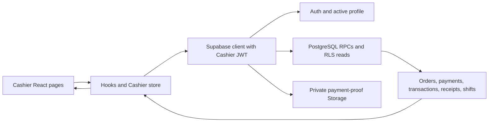

# RRJ’S FOOD-HOUSE Cashier Module — final technical and functional documentation

**Evidence date:** October 21, 2026. **Scope:** the active React Cashier module and its existing Supabase contracts. This document describes implemented behavior; it does not certify real payment settlement or physical printing.

## 1. Module overview

The Cashier Module supports counter sales, review of manually submitted online GCash payments, order monitoring, receipts and transaction records, and per-shift cash reconciliation. An authenticated active Cashier uses the React interface; consequential payment, sale, order, and shift changes go through Supabase/PostgreSQL operations. The interface presents recorded values and does not determine the final price or shift settlement on its own.

## 2. Implemented workspaces

| Workspace | Purpose and primary actions | Data and backend integration | Control and operational limit |
| --- | --- | --- | --- |
| Dashboard | See the active shift, attention items, work queue, and links to Cashier tasks. | Cashier store hydrates orders, current-shift sales, online payment queue, open shift, and menu; an orders/status Realtime subscription refreshes state. | Counts and drawer figures are operational views. An unavailable server refresh is surfaced; the dashboard is not the settlement record. |
| Walk-in POS | Choose available items/modifiers, review a basket, accept cash sale details, and preview a resulting receipt. | Menu reads and `create_walk_in_sale` RPC. The server validates availability, computes recorded prices/discount/tax/total/change, and creates linked order, payment, transaction, and receipt identifiers. | Requires an eligible open shift. The client retains a request ID for uncertain-response recovery; it does not recalculate authoritative totals. A live sale should not be created solely for a read-only demo. |
| Pending Payments | Inspect submitted online GCash details/proof and manually verify or reject an eligible payment. | `get_cashier_online_payments`, private proof access, `verify_customer_gcash_payment`, and rejection RPC. | Submission is not proof of merchant settlement. A Cashier must compare evidence manually. The existing `ORD-000061` pending item was left unresolved in this finalization. |
| Order List | Review current work and older backlog, search/filter, inspect details, and perform available operational actions. | Authorized order reads, order/history hydration, assignment-status read RPC, and specific operational RPCs for actions. | Status, payment and Rider assignment are distinct. The view does not silently reclassify older orders or bypass payment/production authority. |
| Transaction History | Inspect current hydrated transactions, completed-sales summary, details/audit, receipt preview, and export CSV. | Current-shift sale hydration for the rendered list; a separate paged, RLS-governed read of `cashier_transactions`/order/shift rows plus existing `get_cashier_sale` RPC for payment fields in CSV export. | Completed amounts alone feed displayed revenue; voided/refunded classifications are separate. Export covers matching authorized historical rows, checks count consistency, and fails if linked data is unavailable. The on-screen list remains the current hydrated dataset and may show fewer rows than a full-history CSV. |
| Shift Settlement | Start a shift, review open-shift cash metrics, enter a closure count when eligible, inspect saved closed shifts. | `get_open_cashier_shift`, `start_cashier_shift`, `close_cashier_shift`, and six-argument `get_closed_cashier_shifts` with bounded paging. | The server blocks closure while an online GCash payment remains pending. The closure RPC saves expected/actual cash and variance; historical cards show saved values. The separate P2 closed-snapshot immutability trigger remains deferred. |

## 3. Functional workflows

1. **Cash walk-in sale:** an active Cashier opens a shift, selects available menu items/modifiers, and submits the cash sale. `create_walk_in_sale` performs pricing and linked inserts atomically. The returned identifiers and recorded amounts hydrate the transaction and receipt preview. A retry with the same request ID is intended to reconcile an uncertain response rather than create another sale.
2. **Manual GCash review:** online checkout creates a pending submission and proof. The Cashier views the proof and details, then chooses verification or rejection only after real-world review. Verification and rejection are separate server operations with role, state and replay checks. This module does not connect to an automated GCash settlement gateway.
3. **Order monitoring:** the Order List distinguishes current work from older backlog and displays payment, fulfillment, and assignment state. Operational actions use the available authorized server contracts; a status shown in the UI is not a client-side financial write.
4. **Transaction and receipt:** a successful sale or verification creates recorded financial links and receipt identifiers. Transaction History displays recorded amounts and status, with a read-only detail/audit drawer. Selecting a receipt opens a preview; only the separate Print control calls the browser print dialog. CSV export is a reporting read and does not create a receipt.
5. **Shift reconciliation:** the Cashier records opening cash and terminal. The open-shift view summarizes recorded completed verified transactions. Closure accepts an actual cash count and any required variance reason; the backend computes and stores the settlement once. A pending online GCash item blocks closure in the server RPC. Saved shifts are read through the historical RPC with role checks and pagination.

## 4. Architecture and data flow

`AuthProvider` derives the application session from Supabase Auth and the current profile. Cashier routes require the correct role. RLS limits direct financial reads, and server functions enforce business transitions. The current Cashier store fetches orders, the online payment queue, current-shift sales, open shift and menu; it subscribes to selected order/history changes for refresh. Historical saved shifts use a separate read-only RPC. The CSV export runs with the signed-in Cashier's JWT, pages direct authorized transaction rows, and uses the existing own-sale read RPC because `payments` has no direct SELECT policy. It uses no service-role key or new export RPC.

## 5. Financial integrity and security

- **Sale authority:** PostgreSQL sale RPC checks menu availability, prices, modifier/discount inputs, shift eligibility and request idempotency. Unique order/payment/transaction/receipt links help prevent duplicate effects. Inventory deduction follows the confirmed-order server workflow.
- **Payment authority:** GCash verification is manual and server validated. Pending, verified, rejected and voided payment states are not interchangeable; an unresolved submission is excluded from completed-sales revenue.
- **Shift authority:** the deployed `close_cashier_shift` P1 guard checks for any pending online GCash payment before writing a settlement. A payment trigger and shared transaction advisory lock serialize pending transitions with closure. The current open shift and pending item were preserved during finalization.
- **Read authority:** deployed P1 SELECT policies require a current active Cashier profile and own-row scope for direct shift and transaction reads; active Managers have their authorized broader read. The six-argument saved-shift RPC enforces active role and Cashier ownership.
- **Export authority:** CSV reads are paged under the Cashier JWT, explicitly limited to that Cashier ID, and require linked order/payment/shift values. The payment link is verified through `get_cashier_sale`. Counts before and after retrieval must agree with the loaded row count. Output excludes phone numbers, internal UUIDs, proof URLs and tokens; text cells are escaped and formula protected.
- **Historical snapshots:** closed-shift values are stored and displayed. A further trigger to harden snapshot immutability against privileged or unintended later writes is deferred P2 work; do not describe it as deployed.

## 6. Testing and validation matrix

| Evidence | Result | Meaning and limit |
| --- | --- | --- |
| TypeScript typecheck, Cashier quality baseline | **PASS** on this export pass; quality baseline reported 11 checks. | Local source/build checks, not hosted runtime access. |
| Existing focused Cashier Transaction History script | **PASS** on this pass. | Synthetic filter, summary and audit behavior. |
| New Transaction History export script | **PASS** on this pass. | Synthetic two-row output, active filters, Manila date, 501-row paging, count mismatch, mocked RLS-scoped read/own-sale RPC links and denial paths, empty and failure paths, duplicate-click gate, CSV parsing/escaping/formula protection, and download initiation schedule. |
| Production build | **PASS** on this pass. | Bundle generation only. |
| Mobile/desktop visual review | **PARTIAL for current release.** Earlier local responsive screenshots and the owner's October 21 hosted screenshots cover rendered views. | This agent did not re-open an authenticated browser or independently inspect every requested viewport after the export edit. |
| Authenticated post-deployment screenshots | **PASS for the supplied rendered observations.** Dashboard, pending payment, Order List, Transaction History and Shift Settlement showed the expected existing data. | Owner-supplied screenshots; no new network trace or transaction was performed here. |
| Isolated P1 authorization and four concurrency scenarios | **PASS** in the earlier disposable PostgreSQL fixture. | Synthetic DB proof, not a hosted mutation test. See `qa/CASHIER-P1-SECURITY-HARDENING-202610.md`. |
| Hosted migration/object verification | **PASS** in the preceding read-only finalization. | P1 records, function, trigger, policies and grants existed; does not prove browser JWT behavior. |
| Authenticated hosted CSV download after correction | **NOT TESTED** | No usable authenticated browser session in this run. |
| Real GCash ledger match, live payment decision, physical receipt printing, live shift close | **NOT TESTED** in this finalization. | Avoid claiming operational outcomes from previews or synthetic fixtures. |

The October 21 manual observations reported two completed Cash receipts of ₱120.00 each and a ₱240.00 completed-sales summary, while one GCash submission remained pending. The open shift showed ₱4,000.00 opening and ₱4,240.00 expected cash; actual cash was not counted. Five historical closed shifts were visible. These are supplied rendered observations, not new database writes or independent bank verification.

## 7. Limitations and remaining improvements

The rendered Transaction History list is hydrated from current-shift sales; CSV now queries all authorized historical rows independently, so the file can legitimately contain more records than the on-screen list. A live authenticated download should be checked once before defense. Large exports require one authorized own-sale RPC per transaction and can take time; they can also fail if the authorized record count changes during retrieval. The UI reports failure instead of silently exporting a partial file. The older unrelated migration-history discrepancies prevent a clean global push preview, although the two P1 versions are reconciled. Hosted JWT/PostgREST role-denial cases, physical printing, live payment/closure outcomes, and the deferred P2 closed-snapshot trigger are not established by this pass.

## 8. Integration boundaries

Customer checkout submits an online order/payment for Cashier review. Manager reporting and approval views consume shared records but are separate authority paths. Production/Kitchen and Rider workflows follow confirmed/released order transitions; the Cashier sees relevant order/assignment status and performs only its authorized actions. Inventory stock consumption is a backend consequence of confirmed-order processing, not a Cashier page calculation. This finalization changed only Cashier Transaction History export and documentation; no Customer, Manager, Production, Inventory or Rider module was modified.

## Source and evidence index

- Active code: `src/modules/cashier/`, especially `transactions/`, `hooks/CashierStore.tsx`, `api/`, and `services/`.
- QA: `qa/CASHIER-FUNCTIONAL-SECURITY-REVIEW-202610.md`, `qa/CASHIER-P1-SECURITY-HARDENING-202610.md`, `qa/CASHIER-POST-DEPLOYMENT-ACCEPTANCE-202610.md`.
- Export verification: `scripts/verify-cashier-transaction-export.mjs` and `scripts/verify-cashier-transaction-history.mjs`.
