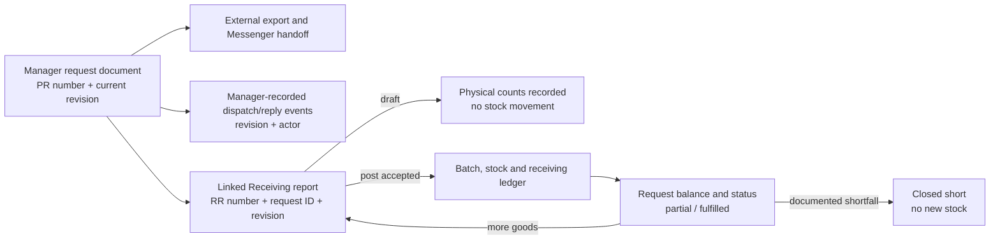

# External formal request traceability

**Date:** 2026-10-14. **Decision:** Formal multi-item Manager inventory requests are transmitted externally through Messenger or shareable documents. Production has no in-app formal request queue or formal-request permissions. The historical single-item Phase 7B queue remains a separate active workflow. This report follows [H-01 browser regression](FULLSTACK-HARMONIZATION-REGRESSION.md) and supersedes the prospective in-app recommendation in the earlier [integration study](PRODUCTION-FORMAL-REQUEST-INTEGRATION-ASSESSMENT.md). Hosted Supabase was not modified or queried for new acceptance evidence.

## Capstone defense explanation

The Manager issues a numbered, versioned **request**. A downloaded or copied document is a representation of that database snapshot. Sending it through Messenger occurs outside the application. If the Manager records a send or reply, the database stores **that Manager's attestation**; it does not prove Messenger delivery, Production acknowledgment, acceptance or in-app Production action. When goods physically arrive, the Manager opens a separate, linked **Receiving report** and records inspected delivered, accepted and rejected quantities. A draft changes no inventory. Posting adds **accepted quantities only** to stock, batches and the movement ledger. Remaining requested quantities stay on the same formal request for another physical delivery or an audited short closure. The historical Production queue retains its own request IDs and transitions.

## Exact authority chain

| Frontend and service | RPC | Database identity/effect | Receiving link and meaning |
| --- | --- | --- | --- |
| `ManagerRequestsPage.tsx` sheet → `inventoryRequestApi.ts.issueInventoryRequest` | `issue_inventory_request` | Inserts `inventory_request_documents` (`id`, unique `request_number`, `current_revision=1`, `status=issued`), current `inventory_request_lines`, revision 1 `inventory_request_revisions.snapshot`, and `inventory_request_events.issued`. | This creates a request, not dispatch or stock. The UI uses the returned PR number. |
| Same page → `reviseInventoryRequest` | `revise_inventory_request` | Checks expected revision and current proposal, updates current document/lines, retains prior snapshots, inserts next revision and `revised` event. A revision is forbidden once any linked Receiving report exists. | A posted or draft delivery cannot silently be retargeted to a new revision. |
| Copy/download/print from current `snapshot` | Browser export only | No database event or state change. Exported text includes `PR-… Rev N`, issuance and line snapshot. | Sharing remains an external human action. The app cannot infer delivery from export. |
| Manager external-record form → `recordInventoryRequestEvent` | `record_inventory_request_event` | Current-revision, active-Manager-only `dispatch` or `acknowledgment` row in `inventory_request_events`, with Manager actor/time and supplied details. The function validates required fields but does not talk to Messenger. | Events neither create Receiving nor move stock. `acknowledgment` is a Manager record of an external response, not a Production login/action or verified acceptance. |
| Manager “Record delivery in Receiving” → `startInventoryRequestReceiving`; posted receipt “Open next linked draft” uses the same service | `start_inventory_request_receiving` | Inserts `receiving_reports` with immutable `inventory_request_id`, `inventory_request_revision`, PR source reference and inspector, plus `delivery_started` event. `one_open_inventory_request_receipt` limits one draft per formal request. | Same formal request can have multiple sequential receipts. Draft creation does not create batch/ledger stock. |
| `StockReceivingPage.tsx` → `receivingApi.ts.getReceivingWorkspace`, `getReceivingPolicyEvidence`, `getInventoryRequestRegister` | `get_manager_receiving_workspace`, `get_receiving_policy_evidence`, `get_inventory_request_register` | Selected report is classified `formal_request` by stored FK. Register projects current PR number/revision/snapshot, lines, posted accepted/rejected/remaining, linked receipts and events. | H-01 calls the formal register only for formal-linked receipts. The on-screen reconciliation uses the same request ID, not a text-only PR match. |
| Receiving line editor → `saveReceivingLine` | `save_receiving_report_item` | Draft `receiving_report_items` carry inventory item, delivered, accepted, rejected and lot/expiry evidence. A guard requires the item to exist on the linked formal request; accepted cannot exceed remaining request quantity on post. | Saving a line is a physical documentation step, not a stock movement. Rejected is delivered minus accepted and is kept separate from undelivered. |
| Receiving posting confirmation → `postReceivingReport` | `post_receiving_report` | Posts once, creates accepted-quantity inventory batch/aggregate/`inventory_transactions` movement. `reconcile_inventory_request_receiving` sums **posted** accepted by request line, changes document status to `partially_received` or `fulfilled`, and records `delivery_posted`. | This is the stock boundary. Rejected and undelivered units do not become stock. |
| Request detail or posted receipt → `closeInventoryRequestShort` | `close_inventory_request_short` | Checks current revision, open status, reason and no open draft; sets `closed_short`, stores closer/time/reason, adds `closed_short` event. | The remaining request is closed with an audit reason; no inventory is added. |

The formal tables and guards are in `supabase/migrations/20261012181744_manager_inventory_request_documents.sql`; source classification and emergency distinction are in `20261013053159_production_delivery_policy.sql`. `get_inventory_request_register` is Manager guarded. No Production formal-table grant or RPC was added. `production_replenishment_requests`, `production_replenishment_status_events`, `get_replenishment_requests` and `advance_replenishment_request` belong only to the historical single-item path in `20261007082647_phase_7b_production_replenishment_requests.sql`.

## Status and quantity interpretation

| Display / stored value | Correct meaning | Does not establish |
| --- | --- | --- |
| `issued` / `Rev N` | Current numbered request revision exists. | Messenger was sent, viewed or accepted. |
| Manager-recorded dispatch | Manager says an external message was sent for **that revision**; event carries actor/time/details. | Independently verified delivery or read receipt. |
| Manager-recorded external reply | Manager says an external response was received for **that revision**. | Authenticated Production action or agreement to every line. |
| `partially_received` | At least some quantity has been **posted as accepted** and one or more requested lines remain open. | All delivered goods were accepted, or a subsequent delivery has occurred. |
| `fulfilled` | Every current request line has cumulatively accepted posted quantity at its requested amount. | External messaging proof. |
| `closed_short` | Manager closed an open request with a reason, leaving any outstanding quantity unreceived. | Stock movement or fulfillment of the shortfall. |
| `remaining` per line | `max(requested_quantity − sum(posted accepted), 0)` across linked receipts. | Rejected quantity; goods not delivered are also outstanding. |

The Manager register and detail show the **current** `request_number` and revision. Earlier snapshots remain available and are not overwritten. Sent/reply indicators check events for the **current revision**, so an event on Rev 1 does not certify Rev 2. A formal receipt stores both the request FK and revision and displays the same PR identity. The source reference is useful to humans, while the FK is the database link.

## Evidence-backed defects and narrow corrections

| Finding | Prior behavior and risk | Correction in this continuation | Verification |
| --- | --- | --- | --- |
| **T-01 — disconnected receipt navigation, confirmed** | “Go to Requests” from a formal receipt switched to the default unsaved request sheet. The user had to find the originating PR manually. | `StockReceivingPage` passes `activeLinkedDocument.id` to the Manager shell; `ManagerRequestsPage` opens history with that ID selected. Button now says **Open linked request**. | **PASS:** isolated Chrome followed posted receipts for `PR-20261014-000003 Rev 1` and `PR-20261014-000001 Rev 2` and returned to each exact PR detail. |
| **T-02 — external evidence wording, confirmed** | “Sent recorded” / “Reply recorded” could sound like independently verified delivery or an in-app Production action. The issue notice omitted the revision. | Badges say **Manager recorded dispatch/reply** or **No … recorded**; the form/notice explicitly says the app does not verify delivery or Production acceptance. Issue/revision success notice includes `Rev N`. Stored event types and payloads are unchanged. | **PASS** for no-event badges in Chrome and TypeScript typecheck. **NOT TESTED** for recorded-event branch and fresh issue notice because existing authorized fixtures have zero dispatch/reply events and no such record was fabricated. |
| **T-03 — potentially stale register, monitored risk** | Refresh is explicit. Another Manager's post or external attestation can change server state while a detail remains open. Server-side expected revision and Receiving guards reject stale writes; a user still needs to refresh to see the latest projection. | No behavior change. Keep explicit Refresh and error display; consider a narrow freshness cue only if observed user confusion warrants it. | Chrome injected one register read failure; visible alert and subsequent Refresh recovery **PASS**. Concurrent-Manager browser behavior **NOT TESTED**. |
| **T-04 — legacy read on formal Requests page, efficiency opportunity** | The collapsed historical `
` mounts `ReplenishmentPage`, and the browser trace included `get_replenishment_requests` while viewing formal requests. This is a read-only call to the separate historical family. | No change in this scope to preserve historical queue behavior. A later frontend-only conditional mount can remove this read after dedicated legacy queue regression. | **Observed** network trace; no claim of data inconsistency. |
| **T-05 — unrelated proposal-read dependency, potential availability risk** | `ManagerRequestsPage.load()` uses `Promise.all` for the stock proposal and formal register. If the proposal read fails, the same catch path leaves the register unavailable even when a Manager only needs to inspect an issued document reached from Receiving. | No change in this scope because splitting load/error states affects request-sheet freshness and needs targeted regression. A later frontend-only change could load the two projections independently while keeping issue/revision disabled when suggestions are stale. | **Source-confirmed risk**, not a reproduced service failure in this run. The injected browser error targeted the register, not the proposal. |

The external-event RPC permits multiple Manager attestations on a revision and does not itself prove message transport. Whether resends, replies without an earlier recorded send, or evidence attachments require stricter policy is a restaurant-owner decision. No new validation rule, column, migration or permission was implemented.

## Verification ledger and limits

| Scope | Status | Sanitized result |
| --- | --- | --- |
| Existing formal issue and revision records | **PASS for persisted history** | Two issued events and one revised event in preserved synthetic slot 1; current `Rev 2` plus prior snapshot visible in Chrome. **Fresh issue/revision action NOT TESTED** in this continuation. |
| Current PR identity, posted RR link, partial/closed navigation | **PASS** | Both synthetic documents and their posted receipts rendered under the matching PR/revision; the new return navigation retained the exact document. |
| Partial, rejected and outstanding reconciliation | **PASS** | Partial PR: requested 5, delivered 3, accepted 2, rejected 1, outstanding 3. Revised closed-short PR: requested 4, delivered 3, accepted 2, rejected 1, outstanding 2. No customer or recipe data was read. |
| Subsequent draft | **PASS in rollback** | Existing partial PR accepted `start_inventory_request_receiving` for a next draft in a local transaction; stock 383 and ledger count 17 remained constant; rollback returned open-draft count to 0. **Second posted delivery NOT TESTED.** |
| Posted accepted-only result | **PASS for existing synthetic postings** | Each linked posted RR has accepted 2, rejected 1, one batch and one receiving ledger movement of +2. **New posting NOT TESTED.** |
| Draft read, refresh and no mutation | **PASS** | H-01 slot 3 formal draft browser proof and this continuation's slot 1 browser aggregate signature, before=after: 2 documents, 8 request events, 2 receipts, 2 receipt lines, 6 batches, 17 ledger rows, summed stock 383. |
| External message delivery or Production acceptance | **NOT TESTED** | No dispatch/acknowledgment event exists in the available synthetic fixture. The application has no Messenger delivery integration. No event was invented for a test. |
| Browser error/retry and role boundary | **PASS / previously PASS** | Current Chrome run showed a register alert after injected network failure and recovery on Refresh. Previous H-01 local run denied Production Manager-route/formal-RPC access; this continuation changed no permissions. |
| Hosted source parity/release | **BLOCKED** | Existing hosted RPC mismatch and migration/disaster-recovery gates still apply. Hosted remained read-only. |

**Confirmed FAIL:** none in the executed local checks. The untested actions above are not counted as PASS. The 51 original migration files, historical queue, preserved demo records, backup assets and Rider APK remain untouched; the only durable changes here are narrow frontend presentation/navigation edits and QA documents.
