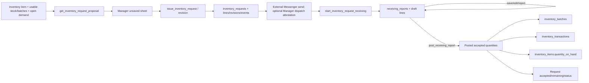

# Full-stack workflow architecture

**Date:** 2026-10-14. The [active feature map](FULLSTACK-FEATURE-DATABASE-MAPPING.md) identifies mounted pages and their service/RPC boundaries. This document explains the business state each operation owns. The isolated [defense run](DEFENSE-DEMO-READINESS-20261014.md) is evidence for representative paths; the [relationship assessment](DATABASE-RELATIONSHIP-INTEGRITY-ASSESSMENT.md) is a separate read-only hosted snapshot.

## Customer order → payment → kitchen → delivery

```mermaid
flowchart LR
  Catalog[Current menu + modifiers + effective availability] --> Cart[Customer provisional cart]
  Cart --> Place[place_customer_order]
  Place --> Order[orders + sold-time order_items]
  Order --> Proof[private payment proof upload]
  Proof --> Submit[submit_customer_payment]
  Submit --> Payment[payments: pending]
  Payment -->|Cashier verifies| Verify[verify_customer_gcash_payment]
  Payment -->|Cashier rejects| Reject[reject_customer_gcash_payment]
  Reject --> Resubmit[Customer resubmits proof]
  Resubmit --> Submit
  Verify --> Receipt[cashier_transactions + order status/history]
  Receipt --> KDS[get_kds_queue_v2: Confirmed → Preparing → Ready]
  KDS --> Release[Cashier release_ready_order]
  Release --> Offer[delivery_assignments: offer]
  Offer --> Rider[Rider accept → pickup → out for delivery]
  Rider --> POD[private delivery-proofs byte]
  POD --> Complete[complete_rider_delivery]
  Complete --> Delivered[orders current status + history; customer tracking/reporting]
```

The Customer cart shows provisional totals from current catalog data; `place_customer_order` is the authority for accepted items, modifiers, prices and `orders`/`order_items` snapshots. A proof upload is a private Storage byte operation; `submit_customer_payment` registers the payment record. The Cashier must verify or reject it through a server RPC. `payments` records tender/proof/verification; `cashier_transactions` records the receipt and shift financial journal. Verification is an internal decision, not proof of external GCash settlement. `orders.current_status` is the current projection and `order_status_history` is the event trail. KDS device credentials authorize queue transition RPCs but do not own order records. Cashier release and rider offer create the delivery handoff; Rider lifecycle RPCs own assignment and resulting order changes. The proof path in `delivery_assignments` is metadata; the actual byte remains private Storage.

Stock deduction is server authority associated with the accepted order/fulfillment transaction, not a UI cart computation. The relevant movement/batch allocation remains distinguishable from `inventory_items.quantity_on_hand`. The local demo reconciled one modified order through Customer browser, Cashier, KDS, Rider emulator, private proof, order/payment/receipt/assignment and no negative batch. This does not establish external payment settlement, physical fulfillment, full hosted deployment, or every cancellation/refund variant.

## Manager request → Production communication → Receiving → stock

The draft is a local preparation surface; issuing creates a numbered, versioned Manager document. Download/copy/print output is a representation of its issued snapshot. Recording dispatch or acknowledgment is an attestation, not an integrated Messenger send or physical delivery. A revised request retains document history. The formal request register is separate from historical Phase 7B `production_replenishment_requests`; `/production` currently completes the latter's acknowledge/prepare/ready workflow. New formal requests reach Production by the explicitly external document process. This is a business process boundary, not an automatic cross-table sync.

`start_inventory_request_receiving` opens a linked physical-inspection draft. Editing a header or line, recording delivered/accepted/rejected quantities, or removing a draft line does not move stock. `post_receiving_report(uuid)` is the only Receiving-to-stock boundary: it validates source and quantities, posts accepted quantity, creates batch/ledger lineage as applicable, updates aggregate stock and request progress, and is expected to be idempotent. Partial acceptance leaves a remainder eligible for another linked delivery or a reasoned short close. Rejected quantity never becomes stock. Direct supplier/PO Receiving is a separate supported source mode with purchase-order-line identity; current hosted PO/secondary-unit branches have zero applicable rows, so live parity is not established.

The Manager Stock page displays an item projection; lot quantities and movement journal are separate grains. Inventory Audit is a bounded ledger read and marks incomplete history rather than claiming a physical count. Waste and adjustments write movement and aggregate/batch balances through dedicated RPCs. Formal request issue, Production status, and draft Receiving are **not** stock movements.

## Supporting state ownership

| Workflow | Source of truth, UI effects and current proof boundary |
| --- | --- |
| Walk-in POS | `create_walk_in_sale` prices and persists sold-time lines, tender/receipt and shift link; Cashier POS receipt and Transaction History read results. Modified local sale passed; physical printing untested. |
| Cashier shift | `cashier_shifts` open/close and `cashier_transactions` journal own expected cash/variance; dashboard summaries are derived. Complete close/reconciliation not repeated in this phase. |
| Paid cancellation | Manager settlement RPC owns `paid_order_cancellations` and related financial/status/stock reversal lineage. Hosted table had no applicable row in the relationship screen; prior isolated rollback-only proof is narrower. |
| Menu management | `menu_items` holds current catalog price/availability. Manager toggles affect Customer/POS reads; sold order snapshots remain immutable. Effective availability may depend on inventory. |
| Rider approval/availability | Manager approval RPC changes `riders` eligibility; Rider `set_rider_availability` controls offers. Assignment status and private proof are separate. |
| Supplier and PO compatibility | `purchase_orders/items` can source direct-supplier Receiving; `PurchaseOrdersPage.tsx` is disconnected mock UI. No active Manager procurement editor is established. |
| Dashboard and reports | Server projections over orders, verified payments, cashier/fulfillment and inventory facts; they are read models, not independent business records. Definitions and date semantics should be checked against RPC code before accounting claims. |

## Current source/hosted boundary

The canonical frontend calls `get_customer_menu_modifiers`, `get_kds_queue_v2` and Receiving policy RPCs. A read-only hosted `pg_proc` name check on 2026-10-14 returned none of those, while it returned `get_kds_queue`, `create_walk_in_sale`, `get_inventory_request_register`, `get_replenishment_requests` and `post_receiving_report`. The missing calls are supplied by local-only migration work and work in the isolated demonstration. Therefore local end-to-end PASS does not imply the same frontend can use those features on hosted. The five local-only migrations, historical clean-replay failure, and recovery gates remain separate prerequisites for a controlled production release; no hosted mutation is proposed as a shortcut.
