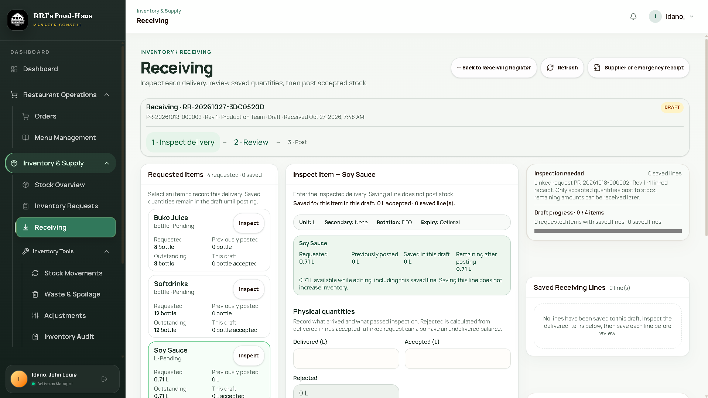
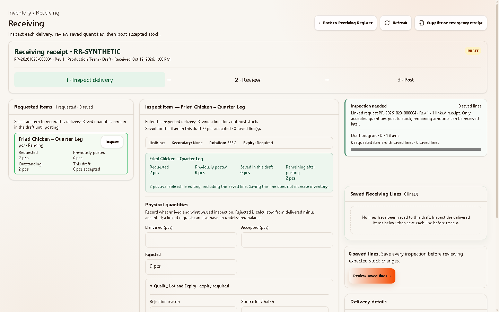

# Manager Receiving visual acceptance — 2026-10-27

## Outcome

The bounded Manager Receiving UI pass is complete. The active Inspect screen now gives the receipt number a prominent heading, spreads Inspect → Review → Post across the receipt card, uses more compact requested-item cards, and balances the three desktop columns. Draft progress, saved lines, the review action, and delivery details remain in that order on the right. The actual draft supplies every quantity and status; no product images or mockup numbers were added. The Inspect → Review → confirmation → Post flow remains unchanged.

## Visual comparison

The reference available in this task was the user's latest desktop screenshot and the approved mockup description from the linked conversation. The original mockup image file was not available in the project or linked conversation attachment list, so a pixel-for-pixel comparison with it was **NOT RUN**. The 1440 capture below is an actual render of the active React component using the disposable synthetic fixture. It does not include the production sidebar.

| Reference current desktop | Final rendered 1440 Inspect |
| --- | --- |
|  |  |

The final render shows a larger receipt heading and full-width tracker, tighter requested-item content, and three aligned columns. The right column still has more vertical space between progress and saved lines than the described mockup, because the taller inspection editor participates in the shared grid rows. This is a visual limitation of this bounded pass; the right panels remain in sequence and are usable.

Final captures: [1280 Inspect](manager-receiving-visual-acceptance-20261027/inspect-1280.png), [820 Inspect](manager-receiving-visual-acceptance-20261027/inspect-820.png), [390 Inspect](manager-receiving-visual-acceptance-20261027/inspect-390.png), [1440 delivery details](manager-receiving-visual-acceptance-20261027/details-1440.png), [1440 Review](manager-receiving-visual-acceptance-20261027/review-1440.png), [1280 confirmation](manager-receiving-visual-acceptance-20261027/confirmation-1280.png), and [1440 posted receipt](manager-receiving-visual-acceptance-20261027/posted-1440.png).

## Exact edits in this pass

- `src/modules/manager/inventory/StockReceivingPage.tsx`: changed only the receipt card wrapper, heading text/size, and step tracker text size.
- `src/styles/theme.css`: widened the stage tracker across the receipt card, tightened requested-item metrics and buttons, and refined the wide desktop three-column grid and right-panel order.
- This acceptance note and its screenshot folder: saved the final fixture renders and the available previous desktop screenshot for comparison.

No Receiving quantity calculation, validation, rejection reason, secondary-unit handling, expiry/lot rule, saved-line lifecycle, error handling, authorization, provenance, or stock-posting call was changed. No hosted data, migrations, six-table retirement, KDS, or unrelated module was changed. Existing dirty work was preserved.

## Verification

| Check | Result |
| --- | --- |
| TypeScript typecheck | **PASS** |
| Production build | **PASS** |
| Receiving draft-authoring source checks | **PASS**, 65/65 |
| Receiving posting source checks | **PASS**, 42/42 |
| Receiving batch-foundation source checks | **PASS**, 48/48 |
| Request proposal contract | **PASS** |
| Request workflow source checks | **PASS**, 40 checks |
| Synthetic browser Register → Inspect/save → Review → confirmation → Post at 1440/1280/820/390 | **PASS**; zero network writes, no browser errors or page overflow |
| Keyboard delivery-details expansion and focus; unsaved edit, invalid-line, and save-failure paths | **PASS** in synthetic browser run |
| Changed-source whitespace check | **PASS** |
| Hosted authenticated Manager flow, real stock posting, production sidebar at four widths | **NOT RUN** |
| Pixel comparison to original mockup image | **NOT RUN**; image file unavailable |

The browser fixture uses in-memory data. Its Post result is a local synthetic check, not evidence of hosted stock changes or posting idempotency in production. UI task closed with the visual limitation noted above.
