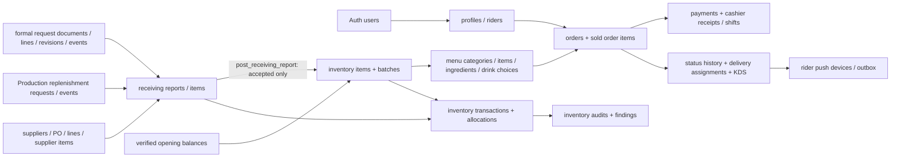

# Track A — backend and database architecture, 26 October 2026

> Historical checkpoint. The Production Queue route has since been removed; current legacy access decisions and retained Manager/Receiving dependencies are recorded in `TRACK-A-LEGACY-BACKEND-CONSOLIDATION-20261026.md`.

**Boundary:** canonical dirty checkout; hosted Supabase `zhzluhqvysvsadwuugpa` inspected read-only. No hosted data, SQL, migration, grant, or RLS change. This is a local application boundary correction and a current architecture map, not a replay or recovery exercise.

## Current source-of-truth map (36 hosted public tables)

The table names and RLS flags below were read from the hosted public catalog on 26 October. All 36 reported RLS enabled. “Current” means the record has an active contract or a conditional business purpose; it does not assert a successful hosted user journey. RPC to table relationships come from migration definitions; frontend calls are cited separately. A zero-row record is retained when its business grain is distinct.

| Domain and authority | Hosted tables | Current/conditional ownership and dependency |
| --- | --- | --- |
| Identity (2) | `profiles`, `riders` | Auth user → app role/profile → rider approval and availability. `src/app/providers/AuthProvider.tsx`, `src/modules/rider/services/supabaseRiderService.ts`; Manager rider reads/actions in `src/modules/manager/riders/RidersPage.tsx`. |
| Catalog and recipe (4) | `menu_categories`, `menu_items`, `menu_ingredients`, `drink_choices` | Current catalog and recipe; drink selections are in `drink_choices`, read by `get_drink_choices` in Customer/Cashier and `get_manager_drink_choices` in Manager. Sources: `src/modules/customer/index.tsx`, `src/modules/cashier/api/menuApi.ts`, `src/modules/manager/api/drinkChoicesApi.ts`, `supabase/migrations/20261021190000_drink_choices_transition.sql`. |
| Order and finance (7) | `orders`, `order_items`, `order_status_history`, `payments`, `cashier_transactions`, `cashier_shifts`, `paid_order_cancellations` | Order current state, sold-time line snapshot, transition events, tender verification, cashier receipt/shift, conditional paid cancellation are separate grains. Sources: `src/modules/customer/index.tsx`, `src/modules/cashier/services/supabaseOrderService.ts`, `src/modules/cashier/hooks/CashierStore.tsx`, `src/modules/manager/api/paidOrderCancellationApi.ts`. |
| Fulfillment and notification (4) | `delivery_assignments`, `kds_terminals`, `rider_push_devices`, `rider_offer_push_outbox` | Assignment/order state and KDS credential are authorities; push device/outbox are delivery support, not order state. Sources: `src/modules/kitchen/services/kdsTerminalService.ts`, `src/modules/rider/services/supabaseRiderService.ts`; Rider push schema is hosted but its writer is outside this canonical web checkout. |
| Inventory and audit (7) | `inventory_items`, `inventory_batches`, `inventory_transactions`, `inventory_transaction_batch_allocations`, `inventory_opening_balances`, `inventory_audits`, `inventory_audit_items` | Item aggregate, physical lots, movement provenance, sold-lot allocation, cutover evidence, immutable audit run and findings. `get_manager_inventory_stock_summary`, `get_manager_inventory_item_detail`, movement RPCs, and `run_manager_inventory_ledger_audit` feed `src/modules/manager/inventory/{inventoryApi,inventoryAuditApi}.ts`. Audit writer/reader definitions: `supabase/migrations/20261019095803_manager_inventory_ledger_audits.sql`. |
| Formal and historical requests (6) | `inventory_request_documents`, `inventory_request_lines`, `inventory_request_revisions`, `inventory_request_events`, `production_replenishment_requests`, `production_replenishment_status_events` | Formal Manager document and historical single-item Production queue are distinct current/compatibility paths. `get_inventory_request_proposal`, `get_inventory_request_register`, `issue_inventory_request`, `revise_inventory_request` feed `src/modules/manager/inventory/inventoryRequestApi.ts` and three Manager views. `get_replenishment_requests`, `create_replenishment_request`, `advance_replenishment_request` feed `replenishmentApi.ts` and `src/modules/production`. Definitions: `supabase/migrations/20261012181744_manager_inventory_request_documents.sql`, `20261007082647_phase_7b_production_replenishment_requests.sql`. |
| Receiving (2) | `receiving_reports`, `receiving_report_items` | Draft is inspection evidence; accepted posted quantity is stock authority only through `post_receiving_report`. Formal request, historical request, and direct supplier/PO source links remain. Frontend: `src/modules/manager/inventory/receivingApi.ts`, `StockReceivingPage.tsx`; SQL: `supabase/migrations/20261003105241_source_neutral_receiving_posting.sql`. |
| Procurement (4) | `suppliers`, `supplier_items`, `purchase_orders`, `purchase_order_items` | Conditional direct-supplier/PO Receiving contract. `supplier_items` catalog bridge has no mounted authoring screen; keep pending owner/client evidence. PO linkage remains in the source-neutral Receiving SQL and Manager Receiving API. |

**Current vs legacy:** the formal request family is current Manager authority; the Production queue is historical compatibility but still mounted. Supplier/PO and opening/allocation/cancellation paths are conditional, not proven redundant. The older 34-table ERD/feature map predates `inventory_audits`, `inventory_audit_items`, `rider_push_devices`, `rider_offer_push_outbox`, and `drink_choices`; its three old modifier tables are absent in the current hosted list. The old feature map also calls formal requests `inventory_requests`; the actual table is `inventory_request_documents`. No table, column, row, index, RPC, grant, or policy is classified safe to remove here.

## Target logical and physical ownership

This diagram is conceptual. Its arrows express data ownership or workflow, not an assertion that every arrow is a declared FK. Physical tables are named in the map above; RPCs are the role and transaction boundary. Stock Overview and Manager Requests consume the same `get_inventory_request_proposal` projection. The server derives usable stock and outstanding quantities, and `issue_inventory_request`/`revise_inventory_request` recheck the expected proposal (`20261012181744_manager_inventory_request_documents.sql:108,182,462`). Client calculations are guidance only.

## Implemented local improvement

**Before:** `getRequestProposal` cast untrusted RPC data to `RequestProposalItem[]`. Stock Overview and Item Detail checked a partial shape in a view helper; Manager Requests did not check it. Stock Overview independently computed `max(0, reorder − valid − outstanding)` with raw floating point subtraction, while Manager Requests used scaled minor units.

**After:** `requestProposal.ts` validates the complete proposal shape, duplicate IDs, nonnegative finite quantities, and the schema’s 0–6 quantity scale at the API read boundary. Invalid guidance rejects the read, so all three mounted consumers use their existing error/refresh paths. Stock Overview uses `suggestedRequestQuantity` from Manager Requests; this preserves the same scale-aware guidance across both screens. The server remains authoritative for issuance and stock posting. No UI flow, request payload, SQL function, or database object changed.

## Gates and limits

| Gate | Result |
| --- | --- |
| Hosted public catalog and relevant RPC names, SELECT/read-only | **PASS**: 36 named tables; request, inventory, Receiving, audit, and replenishment RPC names observed. This is catalog evidence, not authenticated execution. |
| Request proposal contract and shared quantity calculation | **PASS**: `node scripts/verify-request-proposal-contract.mjs` (valid/invalid payload and precision cases). |
| Stock Overview and request workflow offline regressions | **PASS**: `verify-h22-inventory-overview.mjs` (21 assertions), `verify-h23-request-workflow.mjs` (40 checks). |
| Typecheck, production build, baseline quality | **PASS**: `npm run typecheck`, `npm run build`, `npm run verify:quality` (11 checks). |
| Hosted authenticated request/Receiving transaction and SQL regression | **NOT RUN**: hosted is read-only; prior synthetic/local checks do not establish this. |

**Changed for this Track A slice:** `src/modules/manager/inventory/{requestProposal,inventoryRequestApi,inventoryOverview,InventoryPage,InventoryItemDetail}.ts(x)`, `scripts/{verify-request-proposal-contract,verify-h22-inventory-overview}.mjs`, and this report. The checkout already had extensive unrelated dirty files; the reported tests assess the current combined tree, not a clean release candidate.

**Next minimal target:** exercise one authenticated *disposable local* Manager proposal → issue → linked Receiving → accepted-only post journey against the current compiled tree, including a malformed proposal response. Keep the hosted project read-only and treat any later database object retirement as a separate evidence-based decision.
